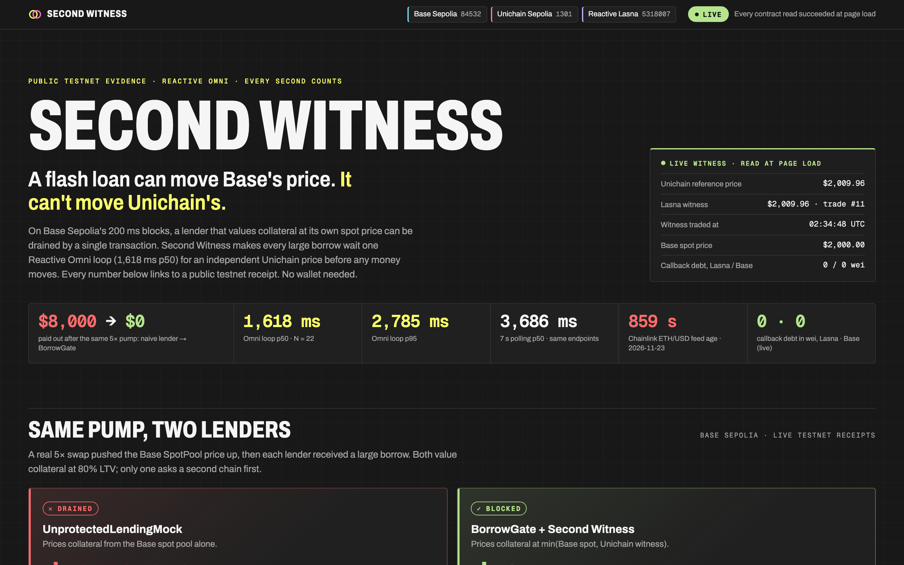
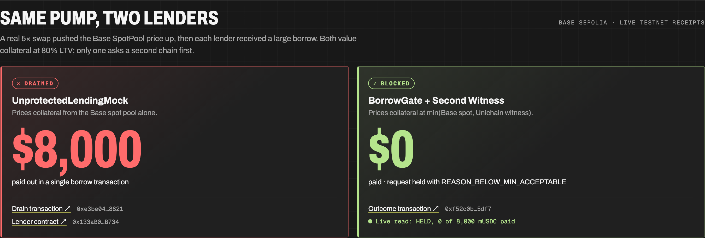
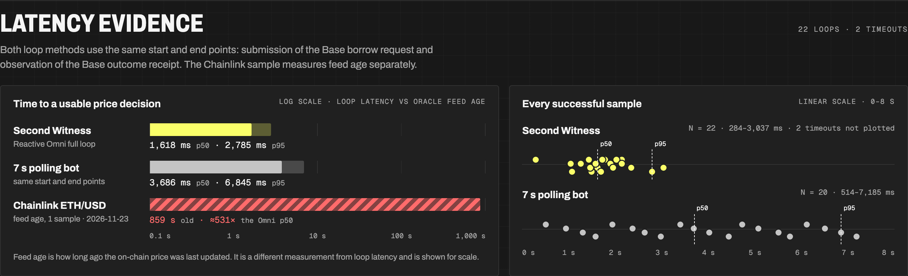

# Second Witness

A spot price can move inside the same Base transaction that uses it to value collateral. Second Witness keeps small borrows synchronous and asks for an independent Unichain price before disbursing a large borrow. Reactive Lasna relays the witness. Base's `BorrowGate` alone decides what can be paid and owns every collateral lock and debt balance.



## Two-minute verification without a wallet

All contracts are live on **Unichain Sepolia (`1301`)**, **Base Sepolia (`84532`)**, and **Reactive Lasna (`5318007`)** (deployed within the competition window, verified `debt == 0` on both Lasna `SYSTEM` and Base `CallbackProxy`). Open the [live evidence dashboard](https://reactive-second-witness.vercel.app) (zero wallet, zero `.env`) or run the read-only `cast` commands below to trace any `requestId` across all four hops.

### Live Testnet Deployments

| Chain | Contract | Deployed Address | Explorer |
| --- | --- | --- | --- |
| Unichain Sepolia (`1301`) | `ReferencePoolWitness` | `0x96c3532eB6aD1269331A26BD22eD2BdbF47616bB` | [Uniscan](https://sepolia.uniscan.xyz/address/0x96c3532eB6aD1269331A26BD22eD2BdbF47616bB) |
| Base Sepolia (`84532`) | `SpotPool` | `0x3bc7Bc7D4A9AE200B97AEb9B9cB1903348334673` | [Basescan](https://sepolia.basescan.org/address/0x3bc7Bc7D4A9AE200B97AEb9B9cB1903348334673) |
| Base Sepolia (`84532`) | `UnprotectedLendingMock` | `0x133aB0676E36dbB3227eBe12Fe1f100b8Fb5B734` | [Basescan](https://sepolia.basescan.org/address/0x133aB0676E36dbB3227eBe12Fe1f100b8Fb5B734) |
| Reactive Lasna (`5318007`) | `SecondWitnessReactive` | `0x8e6EB6c323668434fe2e6385787839b946Bd09A3` | [Reactscan](https://lasna.reactscan.net/address/0x8e6EB6c323668434fe2e6385787839b946Bd09A3) |
| Base Sepolia (`84532`) | `BorrowGate` | `0x7121b46B98EC86e5D319a28F9b852756a3305d84` | [Basescan](https://sepolia.basescan.org/address/0x7121b46B98EC86e5D319a28F9b852756a3305d84) |

### Verified 4-Hop Showcase Receipts



| Scenario | `requestId` | Base Origin | Unichain Reference | Lasna Verdict | Base Outcome | Local test |
| --- | --- | --- | --- | --- | --- | --- |
| Flash-loan blocked (`$8k` drained on `UnprotectedLendingMock` [tx](https://sepolia.basescan.org/tx/0xe3be041129202009e89f3c0f8c90e69aa699df6b7f26ec0a0ad802e3f4d98821); `$0` on `BorrowGate`) | `0x78a5e55b…52a5a` | [0x7b502755…](https://sepolia.basescan.org/tx/0x7b5027551c08565a6802f7c0d5c590cc7b10260543b38b08bed0ec4cd0362f1f) | [0xa7d560af…](https://sepolia.uniscan.xyz/tx/0xa7d560afa2aaacbc4b02ce9f7d9d6f74bf7b2fc211f2802745b1f5eec8674086) | [0x04237577…](https://lasna.reactscan.net/tx/0x042375779cdc809b06ad6b3cc5f2059cfe0b19ff7586feb3230913cae2406742) | [0xf52c0bdd…](https://sepolia.basescan.org/tx/0xf52c0bdd539ac70d37d05f10152af728830a0b8a7a5a24473b50ffef11095df7) (`HELD`, `$0`) | `test_fiveXSpotSwapDrainsNaiveLenderWhileBorrowGateBlocksAndCaps` |
| Synchronized settle (1 callback, `2,937 ms`) | `0xbc71198c…c0c3f1` | [0x1f13b917…](https://sepolia.basescan.org/tx/0x1f13b9170e4541ede234902c0d7ac8b06fa346530b793ce6e0a64ab77a695419) | [0xccd20719…](https://sepolia.uniscan.xyz/tx/0xccd207196bcb314085f9ba692e05d44444f05baff553c75012223e54392fdbf4) | [0x6319c85c…](https://lasna.reactscan.net/tx/0x6319c85cafc8d1a26c77ab996f381b879278f7d50da0d8dfd75180c294205f24) | [0x9c9fc660…](https://sepolia.basescan.org/tx/0x9c9fc6607cbd56cc72d21c961fa8c08a1668c8a8793b8a4be1cb86b3c7e04092) (`SETTLED`, `1,000 mUSDC`) | `testFreshWitnessCorrelatesInitialVerdictAndSettlesThroughProxy` |
| Stale hold (`>30s`) → 2 fresh Unichain trades auto-release (`rev 2`) | `0x82b7808c…78ef7c` | [0x195809b2…](https://sepolia.basescan.org/tx/0x195809b2840cb9e8e5501f78564de1b4c08246f34d2842d5ef29026563311d53) | [0x138cf8db…](https://sepolia.uniscan.xyz/tx/0x138cf8db80c6584bf7aabf2b5d32171110f0a2454577658be6239a4709b788e7) | [0x2a64492a…](https://lasna.reactscan.net/tx/0x2a64492a762de88632b74c5911534a3b23c1653e953a5c027a9d21957c92f1e5) | [0xb16b687e…](https://sepolia.basescan.org/tx/0xb16b687e4c43be079f9972fa1f819881fba5be0edb5c1b99082b1fd7a22cf1c6) (`SETTLED`, `rev 2`) | `testStaleWitnessSettlesOnlyAfterTwoNewReferenceTrades` |
| Local cancel / expire (`cancelRequest` releases 100% collateral) | `0xd2fcc33f…591f3d` | [0x092390d4…](https://sepolia.basescan.org/tx/0x092390d41c0da1b660ad5d091690bba43d582ff400863fbbe962f1fffd4a1780) | [0x138cf8db…](https://sepolia.uniscan.xyz/tx/0x138cf8db80c6584bf7aabf2b5d32171110f0a2454577658be6239a4709b788e7) | [0xe552a73c…](https://lasna.reactscan.net/tx/0xe552a73c41e31e7b4b306ef98be1b1404da0cf2e841d594cf70fe6af213345c2) | [0x8194ce0b…](https://sepolia.basescan.org/tx/0x8194ce0b9b5e56d5016be62bcc152660557f027051e23c5314f8ea144a88d8f6) (`CANCELLED`, `kept=0`) | `test_cancelAndExpireAuthorizeAndReleaseUndisbursedReservations` |

`LIVE` means every required contract read succeeded at page load. `DETERMINISTIC_REPLAY` explains the failed endpoint and keeps published receipt links available. A live getter shows the current state, while the linked receipt proves what happened in that transaction.

### Measured Latency Comparison (2026-11-23 Live Testnets)



| Evidence | Measurement | Successful samples | Timeouts / failures | Range (min – max) | p50 / p95 |
| --- | --- | ---: | ---: | --- | --- |
| Reactive Omni full loop | Base `BorrowRequested` mined → Base `BorrowOutcome` observed (same endpoint) | 22 | 2\* | `284 ms` – `3,037 ms` | **`1,618 ms` / `2,785 ms`** |
| 7 s polling baseline | Same Base RPC endpoint, 7,000 ms fixed polling cadence + RPC check | 20 | 0 | `514 ms` – `7,185 ms` | `3,686 ms` / `6,845 ms` |
| Chainlink Base Sepolia ETH/USD | Feed age (`head - updatedAt`) on `0x4aDC67696bA383F43DD60A9e78F2C97Fbbfc7cb1`, sampled 2026-11-23 | 1 | 0 | `859 s` (`14m 19s`) | — |

\*The 2 recorded timeouts occurred on run 10 when the initial `0.25 lREACT` Lasna reserve briefly hit `debt = 0.020 lREACT` and halted callback delivery; topping up via `SYSTEM.depositTo(reactive)` immediately cleared debt to `0` and all remaining 13 loops completed with `0` timeouts and final `lasnaDebt == 0`, `baseDebt == 0`. All 22 raw durations (in ms) are bundled in `dashboard/src/data/verified-receipts.json`.

## Where decisions happen

```text
Unichain Sepolia 1301        Reactive Lasna 5318007              Base Sepolia 84532
ReferencePoolWitness ──────► SecondWitnessReactive ◄─────────── BorrowGate + SpotPool
       ReferenceTrade         latest witness + hold slots       BorrowRequested / BorrowClosed
                              │
                              └──── SYSTEM → CallbackProxy ───► BorrowGate
                                        witness verdict         collateral, debt, payouts
```

Base checks how old the witness is and caps the price at the lower of its local spot and the Unichain reference. If that price cannot support the borrower's minimum, Base holds the request. Fresh Unichain trades can trigger another verdict. If the callback path stalls, the borrower can cancel on Base, and anyone can expire the request at its deadline.

| Invariant | Base ledger property |
| --- | --- |
| P1 | Active debt locks plus pending reservations stay within the borrower's total collateral. |
| P2 | Cumulative payout stays within the request amount. Any positive payout meets the borrower's minimum. |
| P3 | A stale, too-far-future, or zero-price witness leaves the payout unchanged. |
| P4 | An older or repeated revision leaves the payout, debt, and status unchanged. |
| P5 | A closed request keeps its payout, retained collateral, and terminal status. |
| P6 | On close, retained collateral covers the payout at the effective price and LTV. Active debt locks match the accounting oracle. |

Deploy in this order because the Base callback receiver binds the Lasna sender in its constructor:

1. Deploy the mock token pair and `ReferencePoolWitness` on Unichain Sepolia.
2. Deploy the mock token pair, `SpotPool`, and `UnprotectedLendingMock` on Base Sepolia.
3. Deploy `SecondWitnessReactive` on Lasna, supplying the Unichain pool address and Lasna reserve funding. Its constructor subscribes to `ReferenceTrade`.
4. Deploy `BorrowGate` with the Base `CallbackProxy`, the Lasna contract as callback sender, and the Base spot pool. Fund the protocol reserves and verify both service-provider debt balances before running the demo.
5. Call `SecondWitnessReactive.configureBorrowGate` once as the owner to subscribe to Base `BorrowRequested` and `BorrowClosed`.

## Reproduce locally

From the repository root, run the two blocks in separate shells. Use [Foundry](https://getfoundry.sh/) for the contracts and Node.js 24 with [pnpm](https://pnpm.io/) for the dashboard.

```sh
forge test -vvv --gas-report
```

```sh
cd dashboard && pnpm install && pnpm test && pnpm build
pnpm preview
```

Open the local URL printed by `pnpm preview`. The static output is `dashboard/dist/`. No wallet, API key, or `.env` is required to build or load it.

## Read-only Cast diagnostics

Run from the repository root with Foundry's `cast` and `jq`. This block reads public values from the bundled JSON and exits early while Ticket 05 is pending. Choose `flash-loan`, `synchronized`, or `stale` to trace a request with all four hops.

```bash
(
  set -eu
  bundle=dashboard/src/data/verified-receipts.json
  scenario=synchronized
  if ! jq -e '.deploymentStatus == "DEPLOYED"' "$bundle" >/dev/null; then
    printf '%s\n' 'Awaiting Ticket 05 live 3-testnet deployment receipts.'
    exit 0
  fi

  base_rpc=https://sepolia.base.org
  unichain_rpc=https://sepolia.unichain.org
  lasna_rpc=https://lasna-rpc.rnk.dev/
  lasna_system=0x8888888888888888888888888888888888888888
  base_proxy=0x476F44b11F5C942c58f4c8E3d0300E5710743585
  reactive=$(jq -er '.contracts.secondWitnessReactive' "$bundle")
  gate=$(jq -er '.contracts.borrowGate' "$bundle")
  request=$(jq -ce --arg scenario "$scenario" '.scenarios[] | select(.id == $scenario)' "$bundle")
  request_id=$(jq -er '.requestId' <<< "$request")

  # Both service-provider debts should be zero for the funded demo.
  cast call --rpc-url "$lasna_rpc" "$lasna_system" 'debt(address)(uint256)' "$reactive"
  cast call --rpc-url "$base_rpc" "$base_proxy" 'debt(address)(uint256)' "$gate"
  cast call --rpc-url "$lasna_rpc" "$reactive" 'latestPriceE18()(uint256)'
  cast call --rpc-url "$lasna_rpc" "$reactive" 'latestTradedAt()(uint64)'
  cast call --rpc-url "$lasna_rpc" "$reactive" 'latestTradeSeq()(uint64)'
  cast call --rpc-url "$base_rpc" "$gate" \
    'requestState(bytes32)((address,uint256,uint256,uint256,uint256,uint256,uint256,uint64,uint64,uint32,uint8))' \
    "$request_id"

  # Find the Base BorrowRequested subscription and look up its UID.
  borrow_requested=$(cast keccak 'BorrowRequested(bytes32,address,uint256,uint256,uint64,uint64)')
  filters=$(cast rpc --rpc-url "$lasna_rpc" rnk_getFilters)
  filter_params=$(jq -ce --arg gate "$gate" --arg reactive "$reactive" --arg topic "$borrow_requested" '
    first((.TopicFilters // .topicFilters)[] | select(.ChainId == 84532
      and ((.Contract // "") | ascii_downcase) == ($gate | ascii_downcase)
      and .Topics[0] == $topic and any(.Configs[];
        .Active == true and ((.Contract // "") | ascii_downcase) == ($reactive | ascii_downcase))))
    | [.Uid]
  ' <<< "$filters")
  cast rpc --rpc-url "$lasna_rpc" --raw rnk_getFilterById "$filter_params"

  cast receipt --rpc-url "$base_rpc" --json "$(jq -er '.transactions.baseOrigin' <<< "$request")"
  cast receipt --rpc-url "$unichain_rpc" --json "$(jq -er '.transactions.unichainReference' <<< "$request")"
  cast receipt --rpc-url "$lasna_rpc" --json "$(jq -er '.transactions.lasnaVerdict' <<< "$request")"
  cast receipt --rpc-url "$base_rpc" --json "$(jq -er '.transactions.baseOutcome' <<< "$request")"
)
```

For local cancellation or expiry, inspect the Base origin and outcome. The Unichain and Lasna hops are only relevant if the request received earlier cross-chain evidence. No diagnostic signs or sends a transaction.

## Updating the evidence bundle

Set `deploymentStatus` to `DEPLOYED` after collecting and verifying the addresses and receipt hashes in `dashboard/src/data/verified-receipts.json`. Keep each `requestId` with its matching `transactions`, and use `null` for unused local-only hops. Record successful durations in chronological order in `latencyBenchmark.samplesMs` and `latencyBenchmark.polling.samplesMs`. Record the number of timeouts and failures separately in each `timeoutCount`. Rebuild the dashboard after replacing the bundle.

## License

MIT. See the root `LICENSE`.
