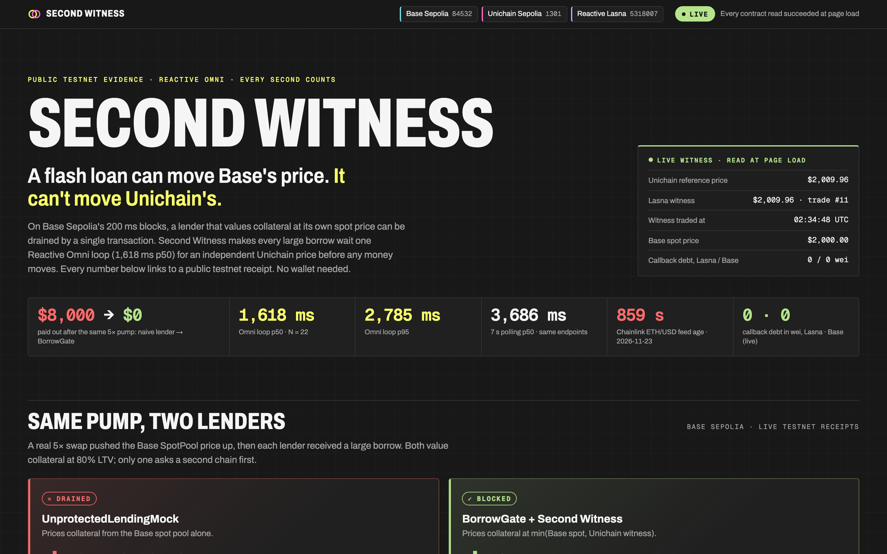
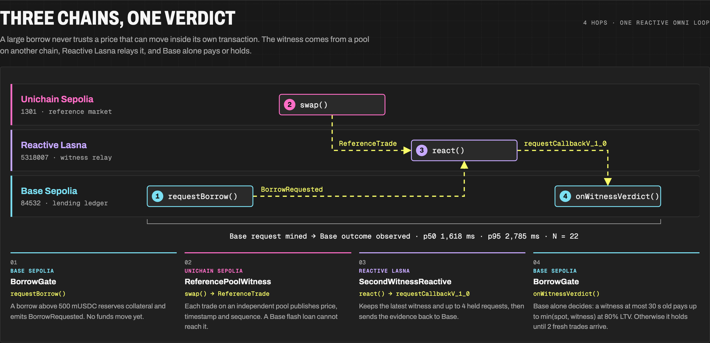
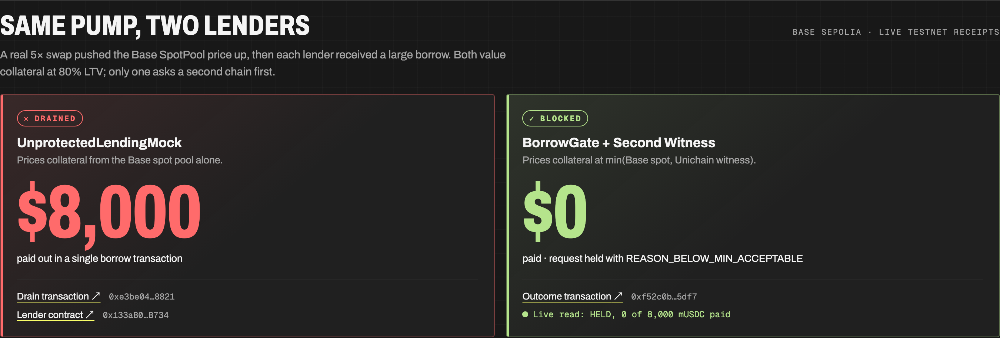
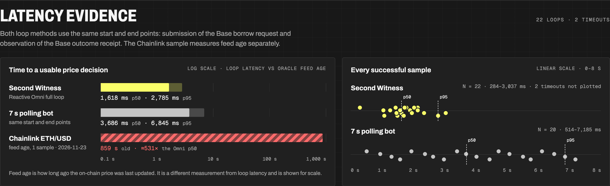

# Second Witness — DoraHacks BUIDL submission (draft)

Draft text for the [Reactive Omni Buildathon](https://dorahacks.io/hackathon/reactive-omni-buildathon/detail), track **Every Second Counts**. Every number below comes from the bundled receipts in [`dashboard/src/data/verified-receipts.json`](https://github.com/GGGODLIN/reactive-second-witness/blob/main/dashboard/src/data/verified-receipts.json) or from the Foundry suite. Fields marked `TODO(submit)` are filled in on the day of submission.

## Submission checklist

The hackathon page asks for four things. This is where each one lives.

| Required by the hackathon page | Where it is |
| --- | --- |
| A link to your public repository | [github.com/GGGODLIN/reactive-second-witness](https://github.com/GGGODLIN/reactive-second-witness) (MIT) |
| Deployed contract addresses | [Deployed contracts](#deployed-contracts) |
| A few transaction hashes showing the full loop, from origin event to callback | [Full-loop receipts](#full-loop-receipts) |
| A demo video under three minutes | `TODO(submit): YouTube URL` (52.6 s, English narration and subtitles) |

## BUIDL name

Second Witness

## One-line pitch

A flash loan can move Base's price. It can't move Unichain's. Second Witness makes every large Base borrow wait one Reactive Omni loop (1,618 ms at the median) for an independent Unichain price before any money moves.

## Track: Every Second Counts

The track asks for "latency numbers measured across the full loop, showing why the idea needs Reactive Omni". Here the loop is the product. A borrow request on Base Sepolia is an event, Reactive Lasna reacts to it with a witness price from Unichain Sepolia, and the callback on Base decides the payout. We measured that loop end to end on live testnets and compared it with a polling bot on the same endpoints.

## The problem

Base Sepolia produces a block every 200 ms since its Denim upgrade. A lender that values collateral at its own spot pool can be drained in a single transaction: push the pool's price up, borrow against the inflated price, and leave. The usual defences each cost time:

- A multi-minute TWAP resists one-block manipulation but lags real market moves.
- A push oracle can be old when you read it. The Base Sepolia Chainlink ETH/USD feed was 859 s old when we sampled it on 2026-11-23.
- An off-chain bot adds a liveness assumption and a polling interval (7 s in our comparison).

## How it works

Three contracts on three chains. Base stays the only ledger.

| Chain | Contract | Job |
| --- | --- | --- |
| Unichain Sepolia (`1301`) | `ReferencePoolWitness` | An independent mETH/mUSDC pool. Every swap emits `ReferenceTrade(priceE18, tradedAt, tradeSeq)`. A flash loan on Base cannot touch it in the same transaction. |
| Reactive Lasna (`5318007`) | `SecondWitnessReactive` | Subscribes to Unichain `ReferenceTrade` and to Base `BorrowRequested` / `BorrowClosed`. Keeps the latest witness and up to 4 held requests in O(1) state, and answers each request with `requestCallbackV_1_0` carrying the witness evidence. |
| Base Sepolia (`84532`) | `BorrowGate` | Owns every collateral lock and debt balance. Borrows up to 500 mUSDC stay synchronous. Larger ones go through `requestBorrow`, and `onWitnessVerdict` pays at most min(spot, witness) × 80% LTV when the witness is at most 30 s old. Otherwise the request is held until 2 fresh Unichain trades arrive. `cancelRequest` and `expireRequest` always work locally. |

All timers use timestamps, not block counts, as the hackathon's ground rules ask for Base Sepolia's 200 ms blocks: `maxEvidenceAge` 30 s, `maxClockSkew` 15 s, `maxRequestTtl` 300 s.

## What it blocked on a live testnet

A real 5× swap on Base `SpotPool` moved the spot price from the pool's starting $2,000 to $10,125. After it, the naive `UnprotectedLendingMock` paid out $8,000 in one borrow transaction ([drain tx](https://sepolia.basescan.org/tx/0xe3be041129202009e89f3c0f8c90e69aa699df6b7f26ec0a0ad802e3f4d98821)). The same large borrow through `BorrowGate` paid $0 and was held with `REASON_BELOW_MIN_ACCEPTABLE` ([outcome tx](https://sepolia.basescan.org/tx/0xf52c0bdd539ac70d37d05f10152af728830a0b8a7a5a24473b50ffef11095df7)).

On testnet the pump and the borrow are separate transactions. An attacker would put both inside one flash loan. `BorrowGate` pays the same $0 either way, because a large borrow is only paid after another chain's witness answers.

## Deployed contracts

| Chain | Contract | Address |
| --- | --- | --- |
| Unichain Sepolia (`1301`) | `ReferencePoolWitness` | [`0x96c3532eB6aD1269331A26BD22eD2BdbF47616bB`](https://sepolia.uniscan.xyz/address/0x96c3532eB6aD1269331A26BD22eD2BdbF47616bB) |
| Base Sepolia (`84532`) | `SpotPool` | [`0x3bc7Bc7D4A9AE200B97AEb9B9cB1903348334673`](https://sepolia.basescan.org/address/0x3bc7Bc7D4A9AE200B97AEb9B9cB1903348334673) |
| Base Sepolia (`84532`) | `UnprotectedLendingMock` (contrast only) | [`0x133aB0676E36dbB3227eBe12Fe1f100b8Fb5B734`](https://sepolia.basescan.org/address/0x133aB0676E36dbB3227eBe12Fe1f100b8Fb5B734) |
| Base Sepolia (`84532`) | `BorrowGate` | [`0x7121b46B98EC86e5D319a28F9b852756a3305d84`](https://sepolia.basescan.org/address/0x7121b46B98EC86e5D319a28F9b852756a3305d84) |
| Reactive Lasna (`5318007`) | `SecondWitnessReactive` | [`0x8e6EB6c323668434fe2e6385787839b946Bd09A3`](https://lasna.reactscan.net/address/0x8e6EB6c323668434fe2e6385787839b946Bd09A3) |

Callback path: Lasna `SYSTEM` `0x8888888888888888888888888888888888888888` → Base `CallbackProxy` `0x476F44b11F5C942c58f4c8E3d0300E5710743585`. Both service-provider debts were `0` when the benchmark finished.

## Full-loop receipts

Each row is one `requestId` traced across all four hops: the origin event on Base, the Unichain trade the witness came from, the Lasna reaction that sent the callback, and the Base outcome.

| Scenario | `requestId` | Base origin | Unichain reference | Lasna verdict | Base outcome |
| --- | --- | --- | --- | --- | --- |
| Flash-loan blocked | `0x78a5e55b…2a5a` | [`0x7b502755…`](https://sepolia.basescan.org/tx/0x7b5027551c08565a6802f7c0d5c590cc7b10260543b38b08bed0ec4cd0362f1f) | [`0xa7d560af…`](https://sepolia.uniscan.xyz/tx/0xa7d560afa2aaacbc4b02ce9f7d9d6f74bf7b2fc211f2802745b1f5eec8674086) | [`0x04237577…`](https://lasna.reactscan.net/tx/0x042375779cdc809b06ad6b3cc5f2059cfe0b19ff7586feb3230913cae2406742) | [`0xf52c0bdd…`](https://sepolia.basescan.org/tx/0xf52c0bdd539ac70d37d05f10152af728830a0b8a7a5a24473b50ffef11095df7) |
| Synchronized settle | `0xbc71198c…c3f1` | [`0x1f13b917…`](https://sepolia.basescan.org/tx/0x1f13b9170e4541ede234902c0d7ac8b06fa346530b793ce6e0a64ab77a695419) | [`0xccd20719…`](https://sepolia.uniscan.xyz/tx/0xccd207196bcb314085f9ba692e05d44444f05baff553c75012223e54392fdbf4) | [`0x6319c85c…`](https://lasna.reactscan.net/tx/0x6319c85cafc8d1a26c77ab996f381b879278f7d50da0d8dfd75180c294205f24) | [`0x9c9fc660…`](https://sepolia.basescan.org/tx/0x9c9fc6607cbd56cc72d21c961fa8c08a1668c8a8793b8a4be1cb86b3c7e04092) |
| Stale hold → auto-release | `0x82b7808c…ef7c` | [`0x195809b2…`](https://sepolia.basescan.org/tx/0x195809b2840cb9e8e5501f78564de1b4c08246f34d2842d5ef29026563311d53) | [`0x138cf8db…`](https://sepolia.uniscan.xyz/tx/0x138cf8db80c6584bf7aabf2b5d32171110f0a2454577658be6239a4709b788e7) | [`0x2a64492a…`](https://lasna.reactscan.net/tx/0x2a64492a762de88632b74c5911534a3b23c1653e953a5c027a9d21957c92f1e5) | [`0xb16b687e…`](https://sepolia.basescan.org/tx/0xb16b687e4c43be079f9972fa1f819881fba5be0edb5c1b99082b1fd7a22cf1c6) |
| Local cancel / expire | `0xd2fcc33f…1f3d` | [`0x092390d4…`](https://sepolia.basescan.org/tx/0x092390d41c0da1b660ad5d091690bba43d582ff400863fbbe962f1fffd4a1780) | [`0x138cf8db…`](https://sepolia.uniscan.xyz/tx/0x138cf8db80c6584bf7aabf2b5d32171110f0a2454577658be6239a4709b788e7) | [`0xe552a73c…`](https://lasna.reactscan.net/tx/0xe552a73c41e31e7b4b306ef98be1b1404da0cf2e841d594cf70fe6af213345c2) | [`0x8194ce0b…`](https://sepolia.basescan.org/tx/0x8194ce0b9b5e56d5016be62bcc152660557f027051e23c5314f8ea144a88d8f6) |

- **Flash-loan blocked**: `HELD`, $0 paid, while the naive lender paid out $8,000.
- **Synchronized settle**: a fresh witness settled 1,000 mUSDC in one callback, 2,937 ms after the request.
- **Stale hold → auto-release**: a witness older than 30 s held the request at revision 1. Two fresh Unichain trades triggered revision 2 and settled 1,000 mUSDC with no polling.
- **Local cancel**: the borrower cancelled on Base while the request was held, and 100% of the reserved collateral came back (`keptCollateral = 0`).

## Measured latency (live testnets, 2026-11-23)

Both loop methods use the same start and end points: the Base `BorrowRequested` transaction mined, then the Base `BorrowOutcome` observed.

| Method | Successful samples | Timeouts | Range | p50 | p95 |
| --- | ---: | ---: | --- | ---: | ---: |
| Reactive Omni full loop | 22 | 2 | 284 – 3,037 ms | **1,618 ms** | **2,785 ms** |
| 7 s polling bot, same endpoints | 20 | 0 | 514 – 7,185 ms | 3,686 ms | 6,845 ms |
| Chainlink ETH/USD on Base Sepolia, feed age | 1 | — | 859 s | — | — |

The Chainlink row is a different measurement: how long ago the on-chain price was last updated, sampled once. It is there for scale. 859,000 ms ÷ 1,618 ms ≈ 531, so that sample was about 531 times older than our median loop. Percentiles use the nearest rank and need at least 20 samples.

The 2 timeouts happened on run 10, when the initial 0.25 lREACT reserve on Lasna ran into debt and callbacks paused. A top-up through `SYSTEM.depositTo` cleared the debt to 0, and the remaining loops finished with no timeouts. All raw durations are in the receipts bundle.

## Safety evidence

- Foundry: 38 tests across 6 suites, all passing.
- Stateful invariant fuzzing of P1–P6 (collateral conservation, bounded and minimum-respecting payouts, no payout on stale evidence, revision idempotency, closed requests stay closed, retained collateral covers every payout) checked after every call: 256 runs × 32 calls = 8,192 calls, 0 reverts, with `fail-on-revert` on.
- A four-slot simultaneous re-evaluation on Lasna is asserted below 800,000 gas. The deployed callback gas limit is 400,000.

## Verify it without a wallet

1. Open the dashboard: [reactive-second-witness.vercel.app](https://reactive-second-witness.vercel.app). The badge reads `LIVE` once every contract read succeeds. It falls back to `DETERMINISTIC_REPLAY` and names the failed endpoint if an RPC is down.
2. Pick a request trace and open its four explorer links. Copy the `requestId` with one click and match it on Base and Lasna.
3. Optional: run the read-only `cast` block in the [README](https://github.com/GGGODLIN/reactive-second-witness#read-only-cast-diagnostics). It reads both debts, the latest witness, a request's state, the Lasna subscription and all four receipts.
4. Optional: reproduce locally with `forge test`, then `cd dashboard && pnpm install && pnpm test && pnpm build`. No `.env`, API key or wallet is needed.

## How it maps to the judging criteria

| Criterion | Where to look |
| --- | --- |
| Execution | Every row in [Full-loop receipts](#full-loop-receipts) links the reactive transaction on Lasna and the callback it triggered on Base. |
| Integration | The reactive contract does the cross-chain work: it watches two chains, keeps the witness, tracks held requests and fires re-evaluations on fresh trades. No off-chain bot is involved. |
| Usefulness | Lenders on fast L2s keep synchronous small borrows and get flash-loan resistance on large ones, at about 1.6 s of added latency instead of a multi-minute TWAP. |
| Craft | Invariant-fuzzed contracts, a zero-env dashboard with 25 Vitest tests, a README you can verify from, and live receipts for every claim. |

## Demo video

`TODO(submit): YouTube URL` — 52.6 s, 1920×1080, English narration and subtitles. One request slip walks the four hops, and every hop stamps a real transaction hash.

## Links

- Repository: [github.com/GGGODLIN/reactive-second-witness](https://github.com/GGGODLIN/reactive-second-witness)
- Live dashboard: [reactive-second-witness.vercel.app](https://reactive-second-witness.vercel.app)
- Demo video: `TODO(submit): YouTube URL`

## Limits we know about

- Testnets only, with mock tokens (mETH, mUSDC) and demo risk parameters; synchronous `smallBorrowLimit` (`500 mUSDC`) is a per-call cap in this demo.
- The 4-slot simultaneous Lasna re-evaluation gas bound (`690,563 gas < 800,000`) is verified in Foundry local simulation (`testFourSlotFanOutGasAndAllCallbacksSettle`); the 22 live testnet benchmark loops ran serially.
- In a transient race where Base closes a slot right before Lasna indexes `BorrowClosed`, a 5th concurrent request still receives its initial `revision = 1` verdict on Base and always retains permissionless local `cancelRequest` / `expireRequest` exit, though automatic `revision >= 2` hold tracking skips if all 4 Lasna slots are still occupied.
- The Chainlink staleness is one dated sample, not a distribution.
- Latency was measured through public RPC endpoints, so it includes their response times.
